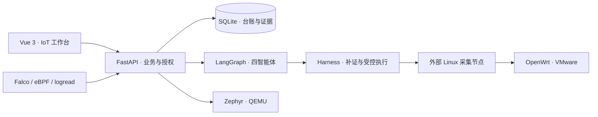

# IoTGuard

**面向多类型物联网设备的多智能体漏洞检测、动态风险研判与受控修复平台。**

IoTGuard 围绕设备身份、软件组件、官方漏洞公告和运行时证据组织安全检测，通过四智能体进行风险研判，再以审批、审计和复验约束修复。当前主要研究对象为 OpenWrt 与 Zephyr RTOS；Ubuntu 用作采集节点、构建宿主和对照环境。

> 当前阶段：平台可运行，两类 IoT 虚拟实例已接入；OpenWrt-Lab 已完成 cgi-io 修复、复验和快照恢复实验。2026-10-20 已修复证据引用、写权限域及凭据问题，并通过真实隔离 QEMU 的宿主签名发布和失败恢复检查，详见 [本轮交付](docs/DELIVERY_20261020.md)。当前验收仅覆盖虚拟设备；宿主签名更新不等于设备侧 OTA/安全启动。逐公告适用性、人工业务签收和长期稳定性仍有开放项；无匹配、无告警或证据不足均不代表设备安全。

## 功能

| 能力 | 实现内容 |
|---|---|
| 设备发现 | 授权网段探测，SSH / HTTP(S) / MQTT / RTSP 指纹，设备身份与组件台账 |
| 情报与匹配 | NVD、CISA KEV、EPSS、Canonical、麒麟情报；OpenWrt / Zephyr 官方公告快照与保守版本范围查询 |
| 四智能体 | 资产调查 → 漏洞分析与运行时分析 → 决策规划；只读补证、证据引用和对象级人审 |
| 运行时取证 | Linux Falco/eBPF、OpenWrt logread；分别展示节点在线、传感器健康与证据新鲜度 |
| 受控修复 | Harness 计划哈希审批、身份校验、资产锁、工具预算、回滚与复验入口；设备写默认关闭 |
| 工作台与审计 | IoT 首页、设备任务、风险、运行时、AgentOps、报告和 Trace；SOC 位于 `/soc` |

## 系统结构



后端容器不加载 eBPF，不持有设备私钥。Linux 传感器和采集节点独立部署；Zephyr 的 SSH、包管理和 eBPF 能力标为不支持。

## 设备与实现状态

| 对象 | 已有实现与验证 | 主要边界 |
|---|---|---|
| OpenWrt | 原机 25.12.6、Lab 25.12.4；各 182 包；Lab cgi-io 机器修复、复验和快照恢复已完成 | 其他候选、配置条件与运行时覆盖待核验；人工业务签收未完成 |
| Zephyr | QEMU `qemu_cortex_a9`，RTOS 4.4.2，应用 0.3.0；构建、HTTP 身份、固件切换、回退与崩溃恢复 | 尚非签名 OTA；无实体板验收；温湿度为模拟数据，熵通道仅适用于受信任 QEMU |
| Ubuntu | Linux 采集节点、Falco、Zephyr 构建宿主及独立克隆修复实验 | 基础设施与对照验证不替代 IoT 设备验收 |

官方公告快照已支持 Zephyr 281 条、OpenWrt 9 条导入与查询；不表示全部依赖 CVE 覆盖或设备漏洞已确认。详见 [产品状态](docs/STATUS.md)。

## 快速启动

需要 Git、Docker Engine / Docker Desktop 与 Docker Compose v2。在项目根目录执行：

```powershell
git clone https://github.com/su12s-ops/IoTGuard-Public.git
cd IoTGuard-Public
Copy-Item backend/.env.example backend/.env.docker
# 本地填写控制令牌；使用模型时配置模型接口与密钥。三个修复开关保持 0。
$env:IOTGUARD_BUILD_REVISION = git rev-parse HEAD
$env:IOTGUARD_BUILD_DATE = [DateTime]::UtcNow.ToString('yyyy-MM-ddTHH:mm:ssZ')
docker compose up -d --build
```

- 工作台：<http://127.0.0.1:18080>
- API 健康状态：<http://127.0.0.1:18000/api/health>
- API 文档：<http://127.0.0.1:18000/docs>

首次启动创建空业务库；设备、节点、情报与模型服务需自行配置。Compose 只启动 API 和前端，外部采集节点和传感器须另行部署。镜像拉取需要可用镜像源。

本地开发使用 Python 3.12+ 和 Node.js 24：

```powershell
Copy-Item backend/.env.example backend/.env
Copy-Item frontend/.env.example frontend/.env
python -m pip install -r backend/requirements.txt -r backend/requirements-test.txt
python -m uvicorn app.main:app --app-dir backend --host 127.0.0.1 --port 8000
# 另一终端：
cd frontend
npm ci
npm run dev
```

开发入口为 <http://localhost:5173>。Docker 与本地开发默认使用不同数据库，数据不会自动同步。详见 [部署说明](DEPLOYMENT.md)。

## 虚拟机与软件环境重建

[环境重建指南](deploy/README.md)提供 OpenWrt / Ubuntu 脱敏 VMware 参数、VMX 生成工具、Ubuntu 依赖安装、Zephyr 构建，以及采集节点和 QEMU 的 systemd 模板。

```powershell
# 使用自己的、已校验的 VMDK；仅生成配置，不启动或修改虚拟磁盘。
python scripts/create_vm_config.py --role openwrt --disk "D:/lab/openwrt.vmdk" --output-dir "D:/lab/iotguard-openwrt"
```

仓库发布源码、脱敏参数与重建入口。虚拟磁盘、镜像、数据库、私钥、真实令牌、运行日志和本地备份独立保存；克隆本仓库不会复制原设备的身份和数据。

## 项目目录

```text
backend/       FastAPI、业务服务、智能体、Harness、迁移与回归测试
frontend/      Vue 3 工作台、Element Plus、ECharts、Playwright 测试
collector/     Linux / OpenWrt 采集、Falco 规则与部署脚本
firmware/      Zephyr 源码、Kconfig、设备树与 QEMU 启动脚本
simulator/     SmartCam 多协议模拟器，供发现联调
deploy/        脱敏虚拟机参数、环境与服务模板
scripts/       本地辅助工具与虚拟机配置生成工具
docs/          产品状态、权限与治理规范
```

## 验证与文档

```powershell
python -m pytest -q
cd frontend
npm run build
npm run test:e2e
```

浏览器测试默认使用 Playwright Chromium，首次运行前执行 `npx playwright install chromium`；Windows 已安装 Edge 时可先设置 `$env:PLAYWRIGHT_CHANNEL='msedge'`。构建通过不代表现场设备连通、全部漏洞已修复或完整安全审计通过。

- [产品状态与待完成工作](docs/STATUS.md)
- [环境重建与软件配置](deploy/README.md)
- [部署说明](DEPLOYMENT.md)
- [技术架构](TECHNICAL_ARCHITECTURE.md)
- [权限与风险治理](docs/SECURITY_MODEL.md)
- [构建与验证](docs/VALIDATION.md)
- [设备验收与收尾边界](docs/DEVICE_ACCEPTANCE.md)

本项目用于授权环境中的安全研究与教学。扫描仅面向显式授权目标；设备写须另行完成身份、作用域、审批和恢复准备。

## 2026-10-20 维护交付

[本轮交付报告](docs/DELIVERY_20261020.md)汇总权限域隔离、注册证据引用、依赖安全升级和虚拟设备验证。[训练与维护规范](docs/TRAINING_AND_MAINTENANCE.md)保留 Git 历史训练材料的可追溯入口。[QEMU 签名更新](docs/VIRTUAL_FIRMWARE.md)仅承诺受信任宿主上的更新与恢复，不等同于设备侧安全启动。
