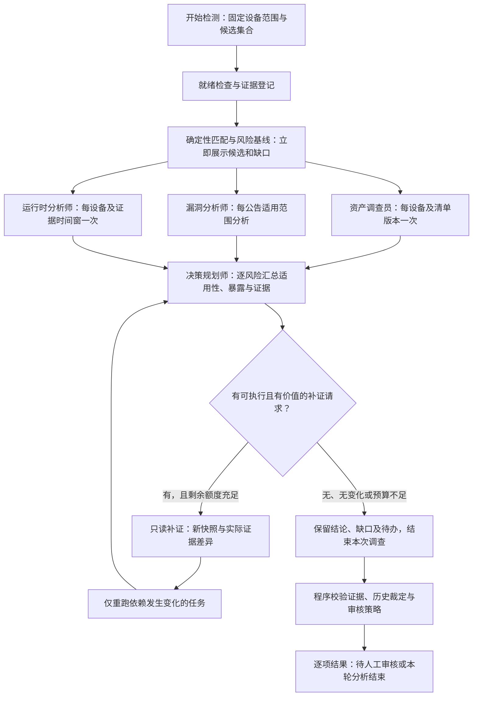

# 多智能体运行架构调整方案

日期：2026-10-25。状态：设计稿，供架构确认与后续分阶段实现。

后续第一版代码实现与实际边界见 [有界任务图运行方式](task-graph-runtime.md)。下文保留原设计与验收目标，不表示所有设计项均已完成。

本次只定义运行架构与验证标准；未修改正式执行代码、路由、预算或运行中的任务。文中的预算与性能数字为待验证的初始设计值，不是已实现的性能承诺。

## 1. 问题与目标

2026-10-25 12:50 左右（北京时间）的实际观测：

- 本轮 10:36 开始，29 项候选风险，第一批选入 20 项，完成 6 项，正在处理第 7 项。
- 前 6 项单项耗时约 14.28–25.44 分钟，平均约 18.93 分钟；每项 9–15 次模型请求、约 16.3–21.2 万 token。
- 6 项均有角色降级，包括证据引用校验失败、协作字段不合法、角色或单项总 token 预算耗尽。
- 进度接口约 22 毫秒返回，页面 HTML 约 2 毫秒返回；这两项测量不代表完整浏览器渲染时间。
- 采集节点不在线，3 个传感器均未处于健康状态，运行时证据过期。模型反复分析缺口不能恢复采集能力。

对应代码：

- `backend/app/services/unified/adapter.py`：逐风险串行执行 `run_unified_sync(..., force_full_review=True)`。
- `backend/app/services/unified/graph.py::node_prepare`：记录分流建议后，正式完整评审仍开启全部四角色。
- `backend/app/services/unified/selective_replay.py`：复用要求相同资产和相同 risk，尚不支持跨风险复用资产调查。
- `backend/app/services/unified/state.py::BudgetState`：默认角色期限 900 秒、单风险运行期限 3600 秒、单风险 20 万 token，范围不等于整轮检测。
- `backend/app/services/unified/adapter.py`：批次进度在单项完整结束后更新。

调整目标：先提供完整、诚实的候选与覆盖信息，再用有边界的专业分析解决具体争议；四角色按职责提供可复用成果，所有风险保留对象级结论、证据、审核与追踪。

## 2. 决定采用的任务结构

运行结构改为有依赖的任务图。四个角色保留，调度、取数、版本比较、证据登记和审核门禁由确定性代码负责。



图中的分支不代表启动所有任务：先由就绪状态与依赖决定任务是否可执行。缺少某类证据时，该分支输出带原因的程序状态，决策仍可汇总其他已完成证据；最终状态保留 `unavailable` 或 `insufficient_evidence`。

### 四角色职责与复用范围

| 角色 | 工作单位 | 输入与产物 | 复用边界 |
|---|---|---|---|
| 资产调查员 | 设备 × 身份/清单/服务/业务环境版本 | 身份可信度、组件存在性、服务暴露、清单缺口 | 同一设备和相同依赖版本内复用；组件特定疑点作为增量问题 |
| 漏洞分析师 | CVE/公告 × 生态/发行分支/源包 × 公告版本 | 官方适用范围、backport 语义、来源冲突、触发条件 | 可共享公告解释；安装版本、设备配置与实际受影响结论必须逐资产核验 |
| 运行时分析师 | 设备 × 证据窗口/传感器状态 × 分析范围 | 已观察行为、关联组件、覆盖、新鲜度、不可支持能力 | 共用窗口分析；按风险查询关联结果；窗口、覆盖或相关新事件变化时失效 |
| 决策规划师 | 资产 × 风险 × 依赖报告版本 | 适用性、实际利用证据、处置紧迫度、建议和缺口 | 逐风险保留独立输出；设备业务环境、报告或政策变化后重新决策 |

同一设备有 15 条 CVE 时，资产调查不再执行 15 次。两个设备命中同一 nginx 公告时，可共享公告解释；两个设备的装机状态、暴露和最终裁定仍分开。Zephyr/OpenWrt/Linux 的能力差异进入输入与校验规则。

对大公告组设大小上限；结构化字段按实际候选范围提供，原文按需只读查询。不能把所有 CVE、全部组件或原始日志放进一个新大提示词。

## 3. 就绪检查和分流

就绪检查按设备和证据类型分别执行，不能因为一个传感器异常而阻断全体设备。

| 输入情况 | 本轮行为 | 对用户的结果 |
|---|---|---|
| 身份与清单可验证、官方范围清晰 | 执行确定性比较，进入需要的专业分析与对象级汇总 | 展示命中依据、证据来源、当前处置建议 |
| 官方来源获取失败，有旧快照 | 标明旧快照时间与获取失败，按适用性限制使用，保留更新待办 | 明确情报时效受限，不表现为最新 |
| 无可用清单或引用登记不一致 | 先登记缺口；可授权只读补采时最多派发一次 | 缺少装机证据，适用性待确认 |
| 运行时源不支持、离线或过期 | 程序直接表达能力/覆盖限制；仍可分析有范围、有时间标记的历史证据 | 无法判断当前利用情况，不得宣告未利用或安全 |
| 高危、KEV、新鲜异常或真实来源冲突 | 提升调查优先级，保留相关专家独立意见与交叉核验 | 优先出结果；紧迫度与静态适用性分别表达 |
| 事实不足且没有可执行的补证手段 | 保留 `insufficient_evidence`，生成具体待办，结束本次调查 | 待补证/待人工处理，并列明下一步 |

低风险分数不能单独触发跳过调查或自动关闭。规则输出首先是“规则基线”，不包装成四智能体结论。现有 `simple` 路径不能直接作为新正式入口启用；它含独立聚合语义，需要与新输出契约一起评估。

## 4. 证据与报告契约

证据、分析报告、任务回执分开保存。模型意见不能注册成原始设备或官方证据。

每个任务至少持久化：

```text
task_id / task_type / asset_scope / risk_scope
dependency_ids / dependency_versions / facts_sha256
pipeline_version / schema_version / prompt_version / model_config_fingerprint
status / origin_task_id / reused / actual_llm_requests
observed_at / started_at / heartbeat_at / finished_at
budget_reserved / actual_usage / stop_reason
report / evidence_refs / unresolved_questions
```

- 先完成真实证据登记与作用域检查，再把可引用的证据送给模型。输入中的来源属性和可引用 ID 分开表达。
- 设备身份、原始清单完整性、生态版本域、官方状态和 backport 语义保留为结构化字段；长文本明确截断并可回查。
- 报告复用须核验依赖版本、设备范围、模型/提示词/模式版本、原任务有效状态、有效期与证据完整性；只靠 TTL 或相同文本不够。
- 每次读取运行时报告重新核验当前新鲜度、传感器覆盖和窗口有效性。事实内容相同但已过期时，也必须改变当前状态。
- 复用是读取既有分析，记录原任务和来源快照；不增加“模型执行次数”，不提高证据强度或置信度。
- 人工裁定与修复审批另行存储；新自动结果不能静默推翻已签收裁定，授权在执行时重新核验。

## 5. 协作与停止条件

协作围绕明确问题和证据变化进行，默认不进行无目标的多轮讨论。

1. 专家先输出简短独立报告：结论枚举、依据引用、冲突、缺口、建议的具体补证请求。
2. 调度器检查补证是否在授权范围、工具是否支持、是否已经做过、预期能回答什么问题；缺少这些条件的请求转待办。
3. 每个风险依赖链默认最多一次补证周期；多个风险对同一事实的请求合并成一项任务。结构纠错与补证分别计数，但共享总预算。
4. 只有相关证据或已验证的事实依赖发生变化，才重跑受影响分析。报告换措辞、重复提问、引用列表排序变化不能触发重新调查。
5. 发现相同输入、相同问题、无事实变化时立即收敛。真实来源冲突未解决时，保留冲突与人审要求，不要求模型“讨论到一致”。
6. 枚举/结构/引用纠错最多一次，限制在原报告和已提供事实中；第二次失败显式降级。不能删除校验器或接受捏造证据来换速度。
7. 达到任务、对象或整轮截止时间后，停止派发新请求；完成项保留，未完成项明确延期。迟到响应不得继续工具调用或覆盖已取消/结束任务。

## 6. 调度与预算：初始试验配置

初期在现有单后端部署中实现有界队列、持久化任务、共享限额和短事务，无需先增加独立消息队列服务。后续多实例部署必须使用数据库租约/原子任务认领协调全局限额。

| 控制项 | 建议初值 | 约束含义 |
|---|---|---|
| 全局在途 LLM 请求 | 2 | 所有角色、风险和补证共享；对象并发与角色并发不能相乘突破此值 |
| 就绪风险任务并发 | 2 | 优先高危/KEV/新鲜异常，队列老化避免低优先级长期饥饿 |
| 单模型请求墙钟期限 | 180 秒 | 请求队列、SDK 重试、工具和纠错纳入上层剩余额度；试验确认模型是否能正常完成 |
| 单专业任务总期限 | 240 秒 | 同一任务的所有请求、工具、纠错共用；决定最终能否运行还受对象和整轮限制 |
| 单风险依赖链总期限 | 8 分钟 | 从该风险进入执行起计；排队时间另外展示，不能重置时钟延长任务 |
| 整轮主动分析窗口 | 30 分钟 | 从点击开始计，包含排队和模型任务；期限到达可得到 partial，不保证全部对象完成 |
| 普通专业任务模型请求数 | 最多 2 次 | 工具请求或最终回答均计数；例外深度调查显式单列且占总预算 |
| 结构/引用纠错 | 最多 1 次 | 占用该任务的请求和时间额度，不能额外叠加 |
| 单风险补证周期 | 最多 1 次 | 新证据到来后可创建有因果关联的新轮次 |
| 角色常规输入 | 估算 4k–8k token | 超出时先按问题拆任务、提取相关证据；保留截断与未覆盖标记 |

token 限额在小样本实测后确定，不直接把当前 20 万 token 硬改成任意小数。每请求在派发前预留“估算输入 + 已配置的最大输出/推理预算”，并在收到真实用量后结算。任务、角色、对象、整轮共享账本；决策有专属保留额度。不能只在响应后检查，任由在途请求继续击穿上限。

输出改为紧凑报告。API 的输出上限可能同时影响推理与正文，须按当前提供方实际行为校准；截断必须视为失败，不接收半截 JSON。不存在通过降低超时就“完成检测”的捷径。

并发任务使用独立数据库会话，不跨线程共享 ORM 对象；模型和网络调用期间不持有写事务。任务幂等键包括类型、范围、依赖版本、策略版本与运行代次；失败/过期的旧任务不能永久阻挡合法重试。取消及恢复均校验代次和租约，重启后不盲目重放副作用操作。

## 7. 前端和结束状态

“开始检测”先展示设备就绪度、当前候选及规则基线，再持续展示专业调查成果。UI 读取后端任务事件/状态，不自行推断完成或安全。

- 分开展示：候选发现完成、专业研判完成、人工审核完成。一个总百分比不能代表三者耗时。
- 显示初始候选总数、已完成、分析中、排队、待补证、待审核、延期项，以及当前角色、已耗时、最近进展时间。
- 重用、程序判定、实际模型执行分别标记。单项有新进展即可更新，不能等整批结束才公布。
- 整轮状态至少区分 `running / awaiting_review / waiting_evidence / partial / completed / failed / cancelled / interrupted`；对象任务状态与整轮状态独立。
- 所有任务处理完但仍有待审核/待补证项时，明确“自动分析结束”及剩余项，不能显示“风险已清除”。预算延期不计成已研判。
- 剩余时间只在有足够同类完成样本时显示区间，并提示受模型响应影响；不做固定速度假进度。
- 继续分析只对明确选中的未完成项创建任务；重复点击复用已有活动任务，不重新同步全量情报或重跑成功对象。

## 8. 验证标准

### 8.1 先验证运行契约

使用假客户端、可控时钟和隔离数据库验证边界；这些测试不能证明真实模型质量或真实提速。

必须覆盖：

1. 同设备多风险只执行一次相同资产任务；同一公告解释可复用，逐资产结论不可串用。
2. 清单、官方来源、业务环境、运行时覆盖/窗口、模型或模式版本变化，正确使对应报告失效；过期/失败报告不可复用。
3. 同问题无新证据时不继续循环；可执行补证最多一次、合并重复请求；无采集能力时保留缺口。
4. 并发下的全局请求限额与 token 预留、决策保留额度、独立会话及幂等认领均有效。
5. 超时、取消、服务重启、SDK 延迟响应和数据库锁冲突不会写出伪完成或重复副作用。
6. 伪造、跨设备、过期或不适用的证据不能获得有效结论；旧人工裁定和修复审批不能被自动绕过。
7. 页面与 API 准确区分候选、模型调用、复用、人审、预算延期；历史记录缺字段时显示未记录。

### 8.2 再验证真实质量与成本

建立至少 12 个独立标注场景，每类至少 2 个，每场景至少 3 次重复：

| 场景类 | 要验证的问题 |
|---|---|
| 厂商精确受影响/已修复 | 版本域与 backport 不被错误覆盖 |
| 来源冲突/厂商调查中 | 不靠模型共识消除事实冲突 |
| 清单缺失/身份不匹配 | 不编造组件存在性或证据 |
| 运行时离线/过期/无能力 | 缺少观测不被解释为安全 |
| 高危/KEV/新鲜异常 | 优先调度，且静态适用性和实际利用分开 |
| 同设备多风险/同公告多设备 | 共享有效、范围隔离、变更失效正确 |

旧完整四角色和新任务图使用同一不可变事实包、相同模型配置和冻结的观察时间，独立保存结果，交错执行降低时段差异。事实哈希必须包含身份、清单、官方版本、窗口与覆盖。随后另做真实时间推进测试验证新鲜度失效；不能把冻结回放当成实时监控验收。

标注由人工在看模型结果前确定，允许正确答案是“证据不足/待补证”。没有可靠标注的场景只计执行和成本，不进入准确率；重复次数不冒充独立场景数。

首轮验收门槛：

| 指标 | 门槛及统计口径 |
|---|---|
| 错误关闭与证据越界 | 标注受影响却自动判不受影响/关闭、伪造或跨对象引用获接受、绕过审批：均为 0；任一出现阻止切换 |
| 语义正确率 | 在标注场景中达到 90% 且不低于同事实旧路径；失败、预算延期、超时保留在分母，不能靠跳过困难项达标 |
| 结构与执行有效率 | 需模型任务中有效完成比例至少 90%；模型失败/截断/耗尽单列；正确识别不可用输入是就绪状态，不伪装成模型成功 |
| 结论稳定性 | 每场景至少 3 次，核心结论一致的场景比例至少 90%；缺样本不记为稳定；稳定错误仍算错误 |
| 同范围耗时 | 完整范围完成率不降低的前提下，整轮墙钟 p50 至少下降 50%；p95、失败时长与排队时长同时披露 |
| 模型成本 | 同事实、同范围的总 token 至少下降 50%；共享任务按整轮计一次；失败/纠错真实用量全部计入，未知用量标记未知 |
| 首批可见结果 | 台账和本地情报快照可用时，候选与覆盖结果目标 60 秒内；冷启动外部同步单独计时 |
| 审核工作量 | 记录每场景人工审核分钟数与待办数量；性能达标但明显增加人审负担时，不宣告整体改进 |

这些阈值用于首轮工程验收，不代表 12 个场景足以证明对所有 IoT 设备有效。p95 样本不足时保留样本数和范围，不给出无根据的总体保证。

`completed` 只表示对应分析任务完成，不天然等于语义正确。pending human review 可以是正确结果，也可以来自模型失败，必须按原因分别统计。30 分钟主动窗口结束但对象未处理完时，计入 partial 与未完成比例，不能拿截止时间冒充全量耗时提升。

## 9. 分阶段实施与切换

1. **证据与任务底座**：修复证据登记/作用域不一致，定义报告与任务契约；补齐对象/角色实时进展和停止原因。先让已有失败可定位。
2. **共享分析任务**：实现设备报告、公告解释、运行时窗口报告及依赖失效；用隔离数据库验证复用与范围，不改正式写入入口。
3. **有界调度**：加入共享请求与 token 账本、任务认领、取消/恢复、优先级与补证收敛。验证数据库短事务和迟到响应隔离。
4. **影子对照**：在相同冻结事实上做新旧策略配对实验；新路径仅写独立分析结果。既有比较器只支持 rules/single_agent/four_agents，需显式扩展新策略标识和报告级复用统计，不能混用名称。
5. **小范围切换**：验收达标后按显式运行配置启用新调度，所有正式结果继续经过唯一 `formal_sink`、证据校验与原审核门禁。原路径保留可选择的回退版本；不允许两条路径同时改写同一活动轮次。

第一版继续使用现有 Vue、FastAPI、LangGraph 和 SQLite。新增的是任务粒度、共享报告和调度契约；若并发/写入负载验证表明 SQLite 无法满足，再评估数据库迁移。

## 10. 参考

- [当前控制台自动流程](console-workflow.md)
- [既有四智能体效率改进](../archive/2026-10-21-agent-improvements.md)
- [现有质量基准与局限](../validation/agent-quality-bench.md)

核心取舍：四角色的独立专业判断继续存在；重复基础调查转成有来源、有作用域、有失效条件的共享任务；无法取得的证据形成明确待办，而不是无限消耗模型时间。
