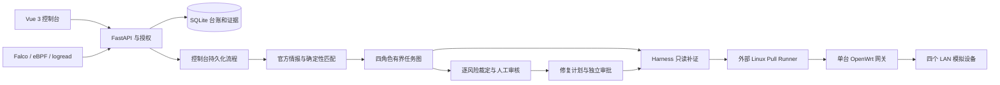

# 技术架构

IoTGuard 的主线是设备发现、官方情报匹配、风险计算、四智能体研判、人工审核、受控修复与复验。当前运行范围见 [项目状态](../status.md)。

## 控制台与数据

Vue 3 页面通过同源 `/api` 请求 FastAPI。Docker nginx 在服务端代理控制请求，真实控制令牌不编入浏览器资源；本地开发使用 Vite 代理。设备、组件、风险、任务、审计与证据由 SQLAlchemy / SQLite 保存，运行数据位于独立目录或命名卷。

“开始”创建持久化 `console_workflow`，依次执行情报同步、匹配、风险计算和正式研判。页面关闭不停止后台任务，阶段进度与剩余对象依据真实状态展示，见 [控制台流程](console-workflow.md)。

## 四角色与耗时

四个角色固定为资产调查员、漏洞分析师、运行时分析师和决策规划师，正式输出仍经过唯一 `formal_sink`。

默认 `task_graph` 通过依赖摘要复用同设备资产调查等报告，对每个风险独立生成最终决策。当前模型请求使用进程内两个并发槽位；实际 HTTP 请求结束前持续占用槽位。预算账本记录请求预留、结算、未知用量和跨批次消耗，不把并行角色的累计耗时当成整批墙钟时间。

超时、预算耗尽、来源冲突或证据不足保留为降级、延期或人审状态。报告复用必须满足身份、清单、事实范围和模式版本条件；事实变化失效，不能直接复用历史安全结论。实现及限制见 [任务图运行方式](task-graph-runtime.md)，目标设计见 [多智能体设计](multi-agent-design.md)。

## 采集与执行

外部 Linux Pull Runner 领取授权任务，通过固定主机指纹执行清单或 logread 采集，回传原文与哈希。API 容器不保存设备私钥，不加载 eBPF。OpenWrt logread 为周期拉取，按原始时间和 boot_id 去重，不具备内核级完整行为覆盖。

Linux 可部署 Falco 或满足目标内核要求的原生 CO-RE 采集器；Zephyr 不具备 Linux SSH、包管理和 eBPF 能力。运行时事件落库与持久化证据任务分开处理，证据具有最终一致性。

## 单网关多设备实验

一台 OpenWrt 在 `br-lan` 上创建四组命名空间与 veth，分别由 DHCP 获得独立地址。procd 监督各 DHCP 客户端与协议服务。模拟器提供 HTTP、MQTT、摄像头 JPEG/MJPEG 和有限 RTSP 发现，身份标记 `simulation`。它们共享网关内核，不是独立固件。见 [LAN 模拟指南](../guides/openwrt-lan.md)。

## 写入与治理

Harness 绑定计划哈希、连接身份、采集器摘要、资产锁、预算和产物注册表。OpenWrt 最终安装入口先核对持久化 `repair_domain`：`production` 仅使用生产开关；`openwrt_lab` 同时要求实验开关和精确资产范围；`unassigned` 拒绝写入。生产开关不授予实验域权限。

标准 Compose 关闭设备、Ubuntu 实验和 OpenWrt 实验写开关。保留历史实验适配器不代表当前需要两台 OpenWrt。模型建议、程序校验、操作审批、设备执行和人工业务接受分别留痕，详见 [权限模型](../reference/security-model.md)。
